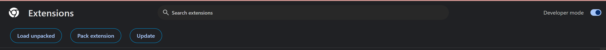

# Digii Deadlines

Digii Deadlines brings upcoming and past assignments from [SNUC DigiiCampus](https://snuc.digiicampus.com/) into a browser dashboard. It uses the campus session you already have open.

## Choose a download

Download the ZIP for your browser from the project's [GitHub Releases](https://github.com/gliminmorais/digii-deadlines/releases), when available, or [build the ZIPs yourself](#build-from-source).

| Browser | Package | Dashboard |
| --- | --- | --- |
| Chrome and Edge desktop | `Digii-Deadlines-chromium-v1.5.0.zip` | Native side panel |
| Brave, Opera, Vivaldi, or another compatible Chromium desktop browser | `Digii-Deadlines-portable-v1.5.0.zip` | Dashboard tab |
| Firefox 140+ desktop | `Digii-Deadlines-firefox-v1.5.0.zip` | Native sidebar with a dashboard tab fallback |
| Safari | `Digii-Deadlines-safari-v1.5.0.zip` | Dashboard tab after Apple packaging |

The desktop Chromium builds need a browser that supports Manifest V3 extensions. Use a current version of Chrome or Edge for the native side panel. The portable build uses a dashboard tab for browsers that support Chromium extensions but have different side-panel APIs. Safari resources need conversion and testing on Apple platforms. Mobile browsers and browsers without compatible extension support are outside this release's verified scope.

## Install on Chromium desktop

1. Extract your ZIP and find the folder containing `manifest.json`.
2. Open your browser's extensions page. In Chrome, open **⋮ → Extensions → Manage extensions** or visit `chrome://extensions`. In Edge, open `edge://extensions`. In other Chromium browsers, open **Manage extensions** in the browser menu.

   

3. Turn on **Developer mode**, select **Load unpacked**, and choose the folder containing `manifest.json`.

   

4. Open or reload [SNUC DigiiCampus](https://snuc.digiicampus.com/) and sign in as usual.
5. Choose **Digii Deadlines** in the browser's extensions menu. The Chromium build opens the native side panel. The portable build opens a dashboard tab.

To update an unpacked installation, extract the new ZIP into the folder you previously loaded. Click **Reload** on the extension card, then reload DigiiCampus.

## Try the Firefox build

On desktop, open `about:debugging#/runtime/this-firefox`, select **Load Temporary Add-on**, and choose the extracted build's `manifest.json`. Open or reload DigiiCampus and click the extension's toolbar button to open the sidebar. The temporary installation expires when Firefox restarts. For regular installation, distribute a version signed by Mozilla. On Firefox for Android, the build is configured to open a dashboard tab and still needs device testing and signing. [Temporary installation guide](https://extensionworkshop.com/documentation/develop/temporary-installation-in-firefox/) · [Mozilla signing and distribution](https://extensionworkshop.com/documentation/publish/signing-and-distribution-overview/)

## Package for Safari

The Safari ZIP contains WebExtension resources. On a Mac with Xcode, extract the ZIP and run the following command with the path to the folder containing `manifest.json`.

```sh
xcrun safari-web-extension-packager /path/to/extracted/safari
```

On older Xcode versions the command is `safari-web-extension-converter`. Build and test the generated app in Xcode, enable its extension in Safari, and grant it access to the SNUC DigiiCampus site. Apple also offers web-based packaging in App Store Connect for developers working without a Mac. Public distribution uses Apple's app packaging and signing process. [Apple packaging guide](https://developer.apple.com/documentation/safariservices/packaging-a-web-extension-for-safari) · [Apple distribution guide](https://developer.apple.com/documentation/safariservices/distributing-your-safari-web-extension)

## Use the dashboard

- **Upcoming** lists unsubmitted assignments in deadline order and links back to DigiiCampus.
- **Past Assignments** groups past and submitted work by subject, with submission status and published marks when DigiiCampus provides them.
- Deadlines use India Standard Time. A timed deadline exactly at midnight is displayed as **11:59 pm the previous day** to make the cutoff clear. The original portal deadline determines sorting and when the assignment leaves Upcoming.
- Use the lightbulb to switch themes. The preference stays in your browser profile, and animations respect your reduced-motion setting.

Leave a signed-in SNUC DigiiCampus tab open in the same browser while you use the dashboard. **Refresh** checks the portal again. If some courses are unavailable, the dashboard shows how many. Digii Deadlines makes read-only requests using your current browser session, keeps assignment data in tab memory, and uses no external services. The assignment fetch has been exercised with simulated portal data. Live behavior still needs verification in an authenticated SNUC session. [Digii API research](https://github.com/Sheikh162/digii-campus-mcp/blob/main/CENSUS.md)

## Build from source

From the repository root, run this with Node.js 22 or newer.

```sh
node scripts/build.mjs
```

The script writes four unpacked folders and four ZIPs to `dist/`. The packages share the same dashboard and DigiiCampus code. Browser-specific settings live in `manifest.json` and `manifests/`. Each ZIP contains the extension runtime files with `manifest.json` at the ZIP root. The install ZIPs exclude the README and screenshots. Run `node --test` to check the dashboard and sync behavior with simulated portal data.

To share the builds, push the source to GitHub, then attach the generated ZIPs to a release as assets. The build workflow also uploads ZIPs to GitHub Actions for review. Chrome and Edge users can load the unpacked build from a release asset. Firefox users can test temporarily or use a signed add-on once available. Safari users need the packaged app. [GitHub release assets](https://docs.github.com/en/repositories/releasing-projects-on-github/managing-releases-in-a-repository)

Made by [gliminmorais](https://gliminmorais.vercel.app/).

