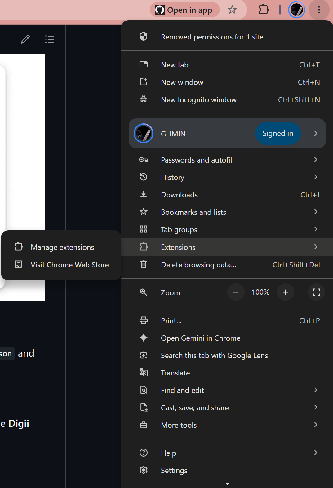

# Digii Deadlines

Digii Deadlines brings upcoming and past assignments from [SNUC DigiiCampus](https://snuc.digiicampus.com/) into a browser dashboard. It uses the campus session you already have open.

## Choose a download

Choose the v1.6.1 ZIP for your browser below. Chrome, Edge, and Brave share the native side-panel build.

| Browser | Package | Dashboard |
| --- | --- | --- |
| Chrome desktop | [Chromium ZIP](https://github.com/gliminmorais/digii-deadlines/raw/main/downloads/v1.6.1/Digii-Deadlines-chromium-v1.6.1.zip) | Side panel |
| Microsoft Edge desktop | [Chromium ZIP](https://github.com/gliminmorais/digii-deadlines/raw/main/downloads/v1.6.1/Digii-Deadlines-chromium-v1.6.1.zip) | Side panel |
| Brave desktop | [Chromium ZIP](https://github.com/gliminmorais/digii-deadlines/raw/main/downloads/v1.6.1/Digii-Deadlines-chromium-v1.6.1.zip) | Side panel |
| Opera desktop | [Portable ZIP](https://github.com/gliminmorais/digii-deadlines/raw/main/downloads/v1.6.1/Digii-Deadlines-portable-v1.6.1.zip) | Dashboard tab |
| Vivaldi and compatible Chromium desktop browsers | [Portable ZIP](https://github.com/gliminmorais/digii-deadlines/raw/main/downloads/v1.6.1/Digii-Deadlines-portable-v1.6.1.zip) | Dashboard tab |
| Firefox 140+ desktop | [Firefox ZIP](https://github.com/gliminmorais/digii-deadlines/raw/main/downloads/v1.6.1/Digii-Deadlines-firefox-v1.6.1.zip) | Sidebar with a tab fallback. Temporary installation instructions below. |
| Safari on Mac | [Double-click installer from the repository](#safari-on-mac) | Dashboard tab |

The desktop Chromium builds need a browser that supports Manifest V3 extensions. Use a current version of Chrome, Edge, or Brave for the native side panel. The portable build uses a dashboard tab for browsers that support Chromium extensions but have different side-panel APIs. Safari needs a separate macOS build as described below.

## Install by browser

### Google Chrome

1. Download and extract the [Chromium ZIP](https://github.com/gliminmorais/digii-deadlines/raw/main/downloads/v1.6.1/Digii-Deadlines-chromium-v1.6.1.zip).
2. Enter `chrome://extensions` or choose **⋮ → Extensions → Manage extensions**.

   

3. Turn on **Developer mode** and click **Load unpacked**. Select the extracted folder containing `manifest.json`.

   

4. Open or reload SNUC DigiiCampus and sign in. Click **Digii Deadlines** in Chrome's Extensions menu to open the side panel.

### Microsoft Edge

1. Download and extract the [Chromium ZIP](https://github.com/gliminmorais/digii-deadlines/raw/main/downloads/v1.6.1/Digii-Deadlines-chromium-v1.6.1.zip).
2. Enter `edge://extensions` in the address bar and turn on **Developer mode**.
3. Click **Load unpacked** and select the extracted folder containing `manifest.json`.
4. Open or reload SNUC DigiiCampus and sign in. Click **Digii Deadlines** in the browser's Extensions menu to open the side panel.

### Brave

1. Download and extract the [Chromium ZIP](https://github.com/gliminmorais/digii-deadlines/raw/main/downloads/v1.6.1/Digii-Deadlines-chromium-v1.6.1.zip).
2. Enter `brave://extensions` in the address bar and turn on **Developer mode**.
3. Click **Load unpacked** and select the extracted folder containing `manifest.json`.
4. Open or reload SNUC DigiiCampus and sign in. Click **Digii Deadlines** in the browser's Extensions menu to open the side panel.

If you previously installed the Portable ZIP, disable that copy on the Extensions page so only the side-panel build is active. [Brave’s side-panel support](https://github.com/brave/brave-browser/issues/31334)

### Opera

1. Download and extract the [Portable ZIP](https://github.com/gliminmorais/digii-deadlines/raw/main/downloads/v1.6.1/Digii-Deadlines-portable-v1.6.1.zip).
2. Enter `opera:extensions` in the address bar and turn on **Developer mode**.
3. Click **Load Unpacked Extension** and select the extracted folder containing `manifest.json`.
4. Open or reload SNUC DigiiCampus and sign in. Click **Digii Deadlines** in the browser's Extensions menu to open the dashboard tab.

### Vivaldi

1. Download and extract the [Portable ZIP](https://github.com/gliminmorais/digii-deadlines/raw/main/downloads/v1.6.1/Digii-Deadlines-portable-v1.6.1.zip).
2. Enter `vivaldi://extensions` in the address bar and turn on **Developer mode**.
3. Click **Load unpacked** and select the extracted folder containing `manifest.json`.
4. Open or reload SNUC DigiiCampus and sign in. Click **Digii Deadlines** in the browser's Extensions menu to open the dashboard tab.

For another Chromium browser that supports unpacked Manifest V3 extensions, use the Portable ZIP and follow that browser's **Load unpacked** steps.

To update an unpacked installation, extract the new ZIP into the folder you previously loaded. Click **Reload** on the extension card, then reload DigiiCampus.

### Mozilla Firefox 140+

1. Download and extract the [Firefox ZIP](https://github.com/gliminmorais/digii-deadlines/raw/main/downloads/v1.6.1/Digii-Deadlines-firefox-v1.6.1.zip).
2. Enter `about:debugging#/runtime/this-firefox` and click **Load Temporary Add-on**.
3. Select `manifest.json` inside the extracted folder.
4. Open or reload SNUC DigiiCampus and sign in. Click **Digii Deadlines** in the Extensions menu to open the sidebar.

The temporary installation expires when Firefox restarts. A regular installation requires a Mozilla-signed build. [Firefox temporary installation](https://extensionworkshop.com/documentation/develop/temporary-installation-in-firefox/) · [Mozilla signing and distribution](https://extensionworkshop.com/documentation/publish/signing-and-distribution-overview/)

### Safari on Mac

1. On the GitHub repository page, choose **Code → Download ZIP**. On your Mac, extract the whole archive and open the extracted folder in Finder.
2. Double-click **Install Digii Deadlines for Safari.command**. A Terminal window opens and runs the setup. Keep the launcher in the extracted folder with the rest of the project.
3. If Xcode is missing, the launcher opens its Mac App Store listing. Click **Get** or **Install**, open Xcode, and complete Apple's first-launch prompts. Return to the setup window and press **Return** when asked.
4. Wait for the launcher to build, install, and open **Digii Deadlines** from `~/Applications`.
5. Open **Safari → Settings → Extensions**, enable **Digii Deadlines**, and allow it to access `snuc.digiicampus.com`. If the extension is missing from the list, turn on **Show features for web developers** in **Safari → Settings → Advanced**, then look for **Allow unsigned extensions** in Safari's developer settings. Safari may ask you to enable this option again after you quit.
6. Sign in to SNUC DigiiCampus in Safari. Click the **Digii Deadlines** toolbar button to open the dashboard tab.

The launcher builds a local copy on your Mac. An Apple-signed app for public distribution is still pending. [Apple’s Safari extension guide](https://developer.apple.com/documentation/safariservices/running-your-safari-web-extension) · [Apple’s distribution guide](https://developer.apple.com/documentation/safariservices/distributing-your-safari-web-extension)

## Use the dashboard

- **Upcoming** groups unsubmitted assignments into **Today**, **Tomorrow**, and **Later**. The cards link back to DigiiCampus and highlight the course and due date.
- **Past Assignments** groups past and submitted work by subject, with submission status and published marks when DigiiCampus provides them.
- Deadlines use India Standard Time. A timed deadline exactly at midnight is displayed as **11:59 pm the previous day** to make the cutoff clear. The original portal deadline determines sorting and when the assignment leaves Upcoming.
- Use the lightbulb to switch themes. The preference stays in your browser profile, and animations respect your reduced-motion setting.

Leave a signed-in SNUC DigiiCampus tab open in the same browser while you use the dashboard. **Refresh** checks the portal again while the current list stays visible. If the refresh fails or some courses could not be loaded, a message beside the last successful sync time tells you to try again. Digii Deadlines makes read-only requests using your current browser session, keeps assignment data in tab memory, and stores the sync timestamp locally in your browser. The assignment fetch has been exercised with simulated portal data. Live behavior still needs verification in an authenticated SNUC session. [Digii API research](https://github.com/Sheikh162/digii-campus-mcp/blob/main/CENSUS.md)

## Demo and architecture

### Watch the public extension in Chrome

[Download the 35-second walkthrough (1080p, 60 fps)](https://github.com/gliminmorais/digii-deadlines/raw/refs/heads/demo-media/docs/digii-deadlines-walkthrough.mp4)

Follow the cursor through Upcoming, Past Assignments, refresh recovery, and the lightbulb theme switch. The walkthrough uses captures of the public v1.6.1 extension running in Chrome with sample assignments, then traces how assignment data reaches the dashboard.

### How it works


1. **Find the DigiiCampus tab.** The dashboard looks for an open campus tab in the current browser window and asks its content script for Upcoming or Past Assignments.
2. **Read and normalise assignments.** The content script uses the existing campus session to fetch the course list and paginate each course’s assignments. It returns the title, deadline, submission status, published marks when available, and a direct assignment link.
3. **Render results and preserve the last successful sync.** Assignment data stays in browser memory. After a complete sync, the background script saves the timestamp in local extension storage. If a later refresh fails or returns incomplete results, the dashboard keeps the list already on screen and shows a retry message.

The public extension uses the campus API directly from your browser. It has no separate backend.

## Build from source

From the repository root, run this with Node.js 22 or newer.

```sh
node scripts/build.mjs
```

The script writes four unpacked folders and four browser ZIPs to `dist/`. The packages share the same dashboard and DigiiCampus code. Browser-specific settings live in `manifest.json` and `manifests/`. Each ZIP contains the extension runtime files with `manifest.json` at the ZIP root. The install ZIPs exclude the README and screenshots. Run `node --test` to check the dashboard and sync behavior with simulated portal data.

The build workflow uploads ZIPs to GitHub Actions for review. The public browser downloads above are checked into the repository under `downloads/v1.6.1/`.

Made by [Glimin S Morais](https://gliminmorais.vercel.app/).

The animated assignment icons use Kubai Icons under the [Kubai Icons License](LICENSE-KUBAI.txt).
